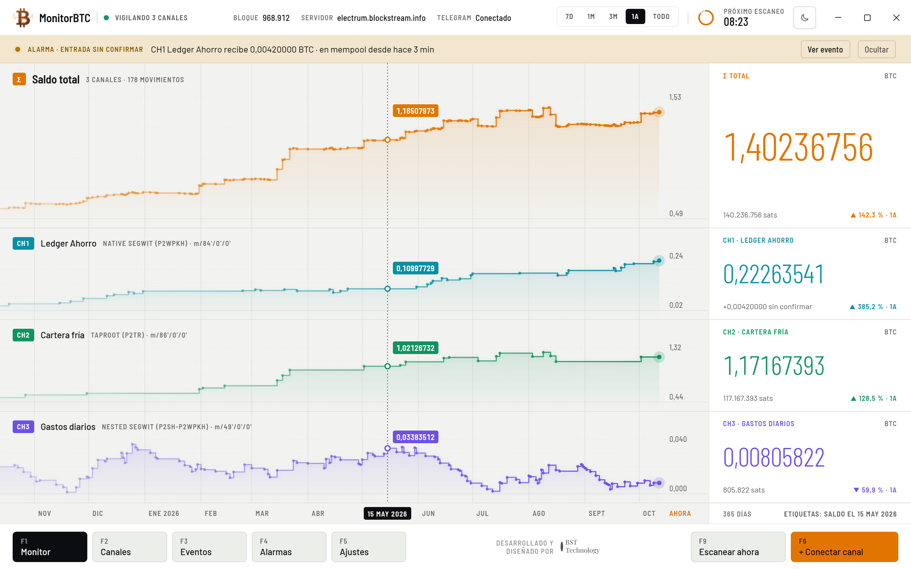
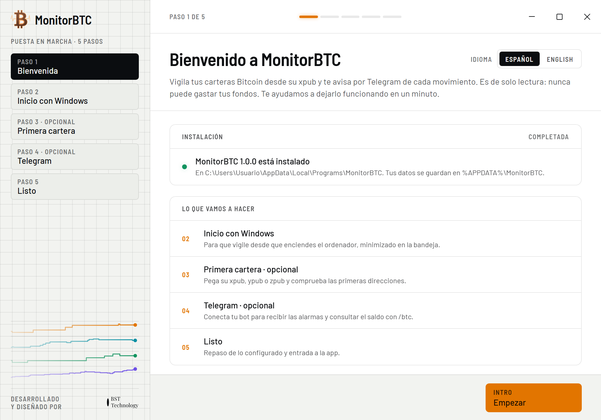
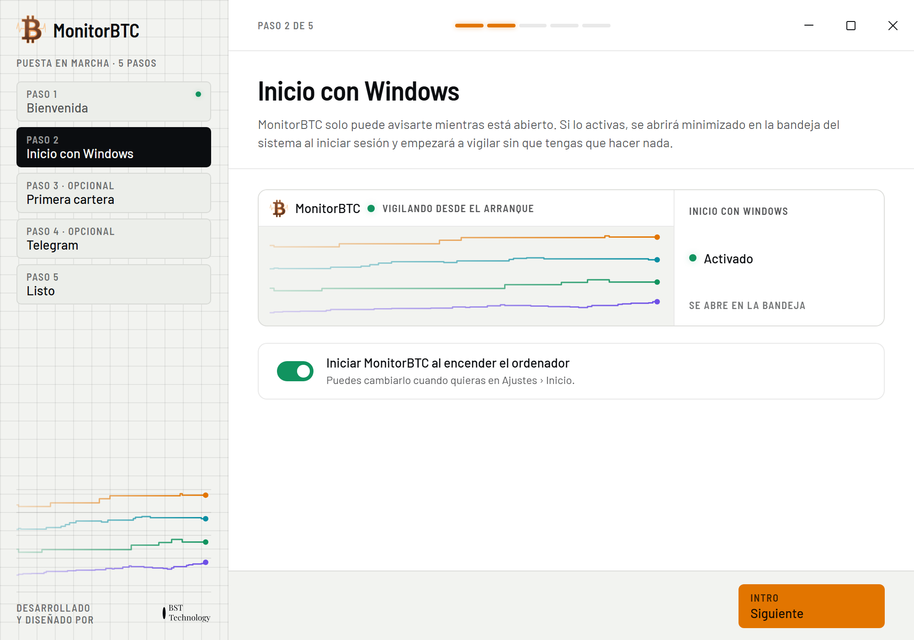
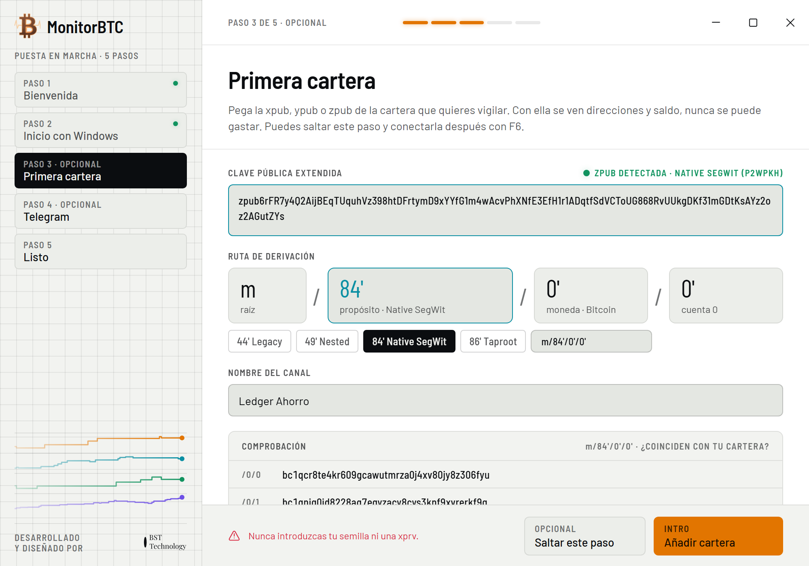
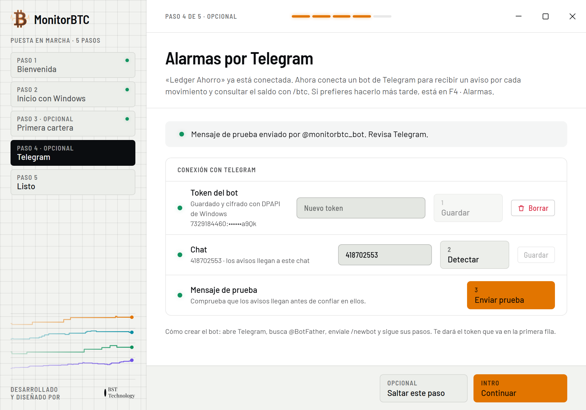
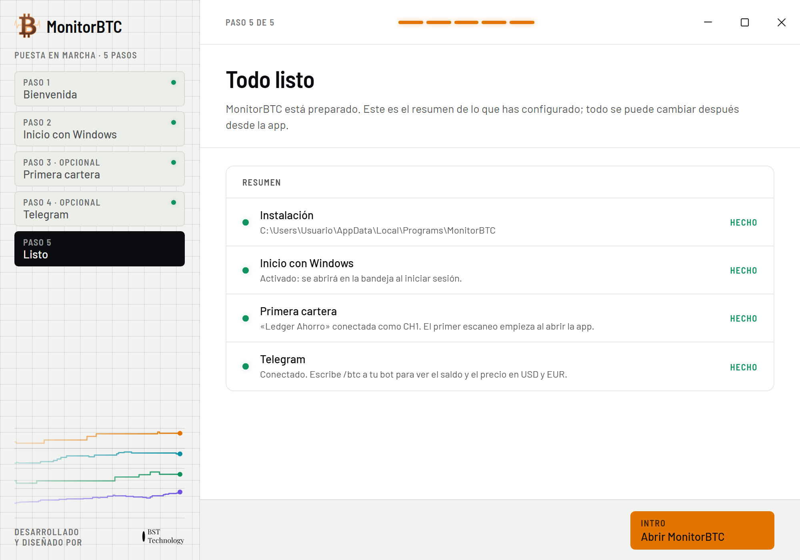
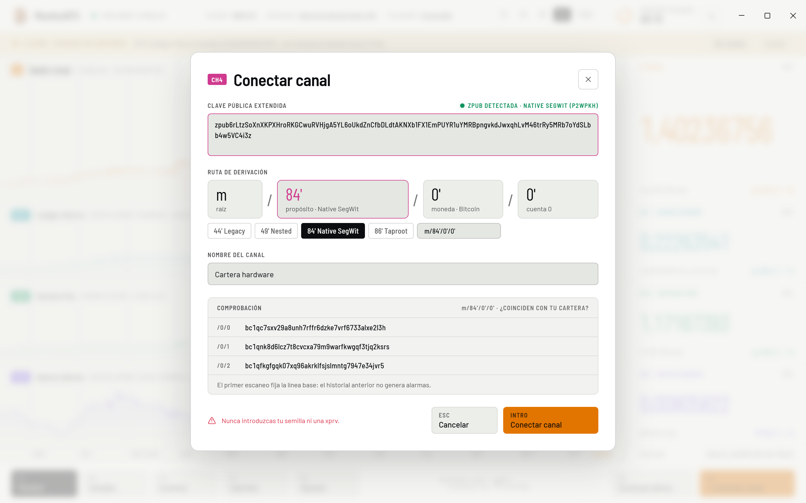
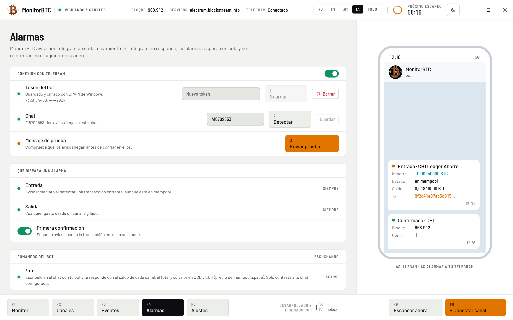
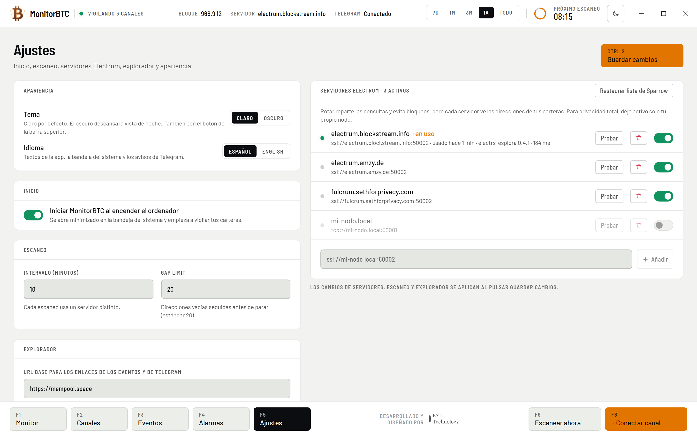

  <a href="README.md">English</a> · <b>Español</b>

# MonitorBTC

MonitorBTC es una aplicación de escritorio para Windows que vigila tus carteras Bitcoin de firma única a partir de su
clave pública extendida (xpub, ypub o zpub) y te avisa por Telegram de cada transacción entrante o saliente.

Es de solo lectura: nunca te pide la semilla y no puede mover tus fondos.

## Descarga

Descarga **`MonitorBTC-Setup-1.0.0.exe`** desde la [última versión publicada](../../releases/latest).

Requisitos: Windows 10 u 11 (64 bits).

## Instalación

1. Ejecuta `MonitorBTC-Setup-1.0.0.exe`. Se instala solo para tu usuario (no hacen falta permisos de administrador) y
   abre MonitorBTC al terminar.
2. Si Windows muestra **«Windows protegió su PC»**, pulsa **Más información** y después **Ejecutar de todas formas**. El
   instalador todavía no está firmado digitalmente, así que SmartScreen no lo reconoce.

## Primera configuración

La primera vez que se abre MonitorBTC, un asistente de cinco pasos te guía en la configuración. Los pasos 3 y 4 son
opcionales (**Saltar este paso**) y puedes hacerlos más tarde desde la aplicación: la cartera con F6 y Telegram con F4.
Si saltas el paso 3, el asistente también se salta el de Telegram.

### Paso 1 · Bienvenida

Elige el idioma (**Español** o **English**) y pulsa **Empezar**. Puedes cambiarlo después en **Ajustes**.

### Paso 2 · Inicio con Windows

MonitorBTC solo puede avisarte mientras está en marcha, aunque solo esté en la bandeja del sistema. Deja activada la
opción **Iniciar MonitorBTC al encender el ordenador** para que se abra minimizado en la bandeja cada vez que inicies
sesión en Windows, y pulsa **Siguiente**.

### Paso 3 · Primera cartera (opcional)

1. Copia la clave pública extendida (xpub, ypub o zpub) de tu cartera desde su aplicación. Por ejemplo: en Sparrow está
   en **Settings › Keystore**; en Electrum, en **Wallet › Information**.
2. Pégala en **Clave pública extendida**. Con una ypub o una zpub, la ruta de derivación se rellena sola. Con una xpub,
   elige el tipo que usa tu cartera: 44' Legacy, 49' Nested, 84' Native SegWit (marcado por defecto) u 86' Taproot.
3. Comprueba que las tres direcciones de **Comprobación** coinciden con las primeras direcciones de recepción de tu
   cartera.
4. Escribe un nombre en **Nombre del canal** (opcional) y pulsa **Añadir cartera**.

> [!WARNING]
> Nunca introduzcas tu semilla (las palabras de recuperación) ni una xprv. MonitorBTC solo necesita la clave pública.

El primer escaneo fija la línea base: las transacciones anteriores no generan avisos, solo las nuevas.

### Paso 4 · Telegram (opcional)

1. En Telegram, abre **@BotFather**, envíale `/newbot` y sigue los pasos. Al terminar te da el token del bot.
2. Pega el token en **Token del bot** y pulsa **Guardar** (1).
3. Abre el chat con tu bot nuevo y envíale `/start`. Después pulsa **Detectar** (2) para rellenar el ID de tu chat.
4. Pulsa **Enviar prueba** (3) y comprueba que el mensaje llega a Telegram. Después pulsa **Continuar**.

### Paso 5 · Listo

Muestra un resumen de lo que has configurado. Pulsa **Abrir MonitorBTC** para empezar.

## Uso diario

| Tecla | Qué hace |
| --- | --- |
| F1 | Monitor: saldo total y un trazo por cartera |
| F2 | Canales: detalle de cada cartera, su dirección de recepción y sus movimientos |
| F3 | Eventos: todos los movimientos, agrupados por día |
| F4 | Alarmas: conexión con Telegram y avisos |
| F5 | Ajustes |
| F6 | Conectar canal: añadir otra cartera |
| F9 | Escanear ahora |

Cerrar la ventana no detiene MonitorBTC: sigue vigilando desde la bandeja del sistema (si no ves su icono, despliega la
flecha ˄ junto al reloj). Haz clic en el icono, o vuelve a abrir MonitorBTC desde el menú Inicio, para recuperar la
ventana. Para salir, haz clic derecho en su icono de la bandeja y elige **Salir**.

### Añadir más carteras (F6)

Pulsa F6 o **+ Conectar canal** para abrir el mismo formulario del paso 3 y, al terminar, pulsa **Conectar canal**.
Cada cartera se convierte en un canal con su propio color.

### Alarmas de Telegram (F4)

- MonitorBTC revisa tus carteras cada 10 minutos por defecto (puedes cambiarlo en **Ajustes › Escaneo**), así que un
  aviso puede tardar hasta ese tiempo en llegar. Pulsa F9 para escanear al momento.
- Recibes un aviso por cada transacción nueva, entrante o saliente, y, si aún no estaba confirmada cuando se detectó,
  otro cuando recibe su primera confirmación (opción **Primera confirmación**, activada por defecto).
- Envía `/btc` a tu bot para ver el saldo de cada cartera según el último escaneo, el total y su valor en USD y EUR. El
  bot solo contesta al chat que has configurado y solo mientras MonitorBTC está en marcha: ignora los comandos enviados
  con el ordenador apagado.
- Si Telegram no responde, los avisos esperan en cola y se reintentan en el siguiente escaneo. Si pausas los avisos con
  el interruptor de **Conexión con Telegram**, los de ese periodo se descartan.

### Ajustes (F5)

Tema (claro u oscuro), idioma, inicio con Windows, intervalo de escaneo (10 minutos por defecto) y gap limit, servidores
Electrum y el explorador de bloques que se usa en los enlaces. Los cambios de escaneo, servidores y explorador se
aplican al pulsar **Guardar cambios** (Ctrl+S).

## Privacidad

- MonitorBTC consulta los servidores Electrum públicos de la lista de Sparrow Wallet, uno distinto en cada escaneo. Cada
  servidor consultado ve las direcciones de tus carteras y tu IP. Para tener privacidad total, añade tu propio nodo
  (`ssl://host:puerto`, o `tcp://host:puerto` si está en tu red local) en **Ajustes › Servidores Electrum**, desactiva
  el resto y pulsa **Guardar cambios**.
- Los avisos y las respuestas a `/btc` pasan por Telegram, que ve los importes, los saldos y los nombres de tus canales.
- El token del bot de Telegram se guarda cifrado con DPAPI de Windows.
- Tus datos se guardan en `%APPDATA%\MonitorBTC`.

## Desinstalar

Ve a **Configuración de Windows › Aplicaciones › Aplicaciones instaladas** (**Aplicaciones y características** en
Windows 10), busca MonitorBTC y elige **Desinstalar** (en Windows 11, desde su menú **⋯**). Al desinstalar también se
quita el inicio con Windows. Tus datos en `%APPDATA%\MonitorBTC` se conservan; borra esa carpeta si también quieres
eliminarlos.

---

Desarrollado y diseñado por [BST Technology](https://bst.technology).
