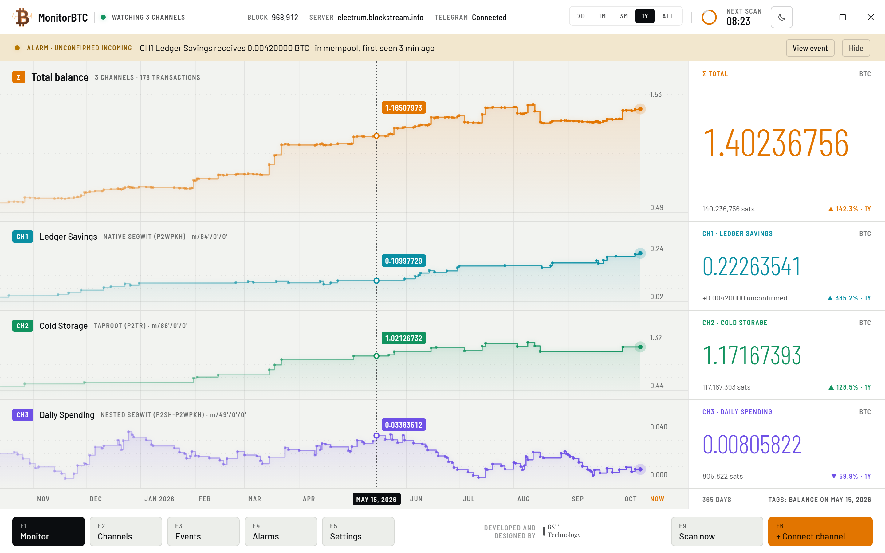
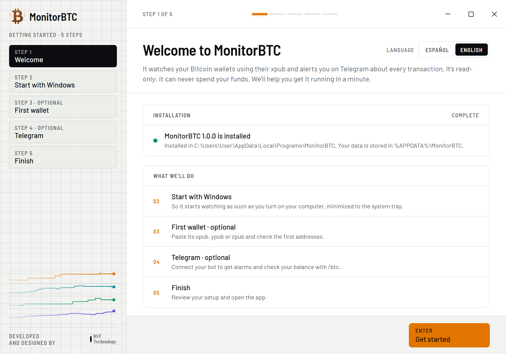
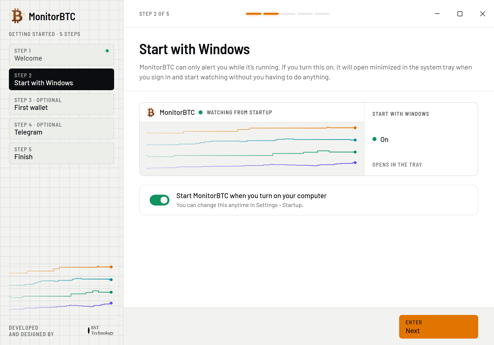
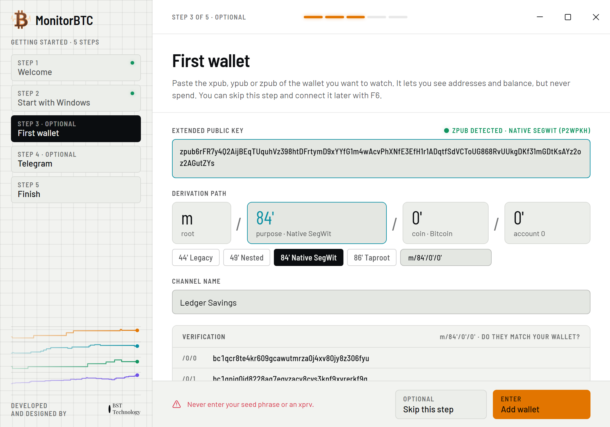
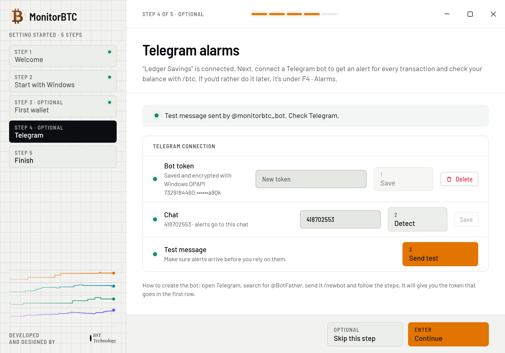
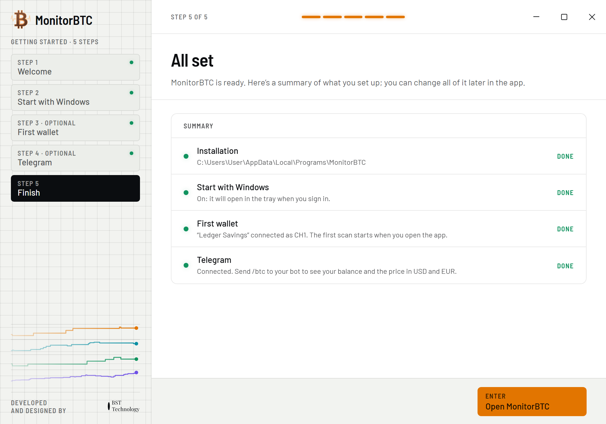
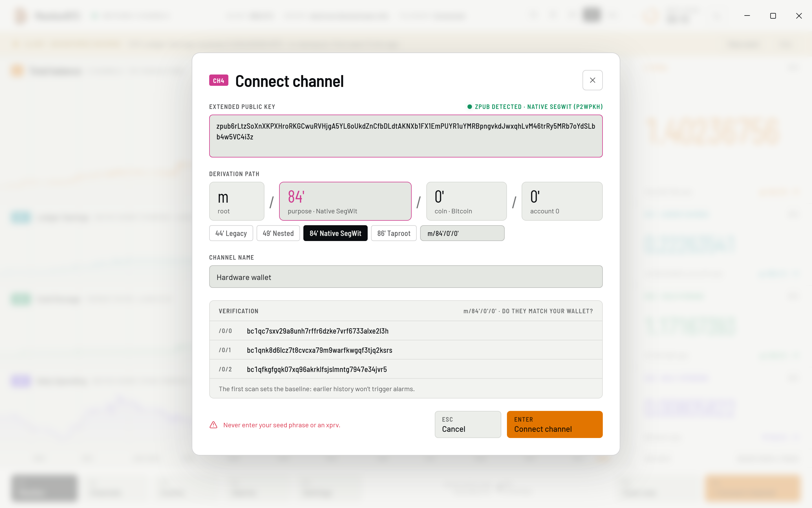
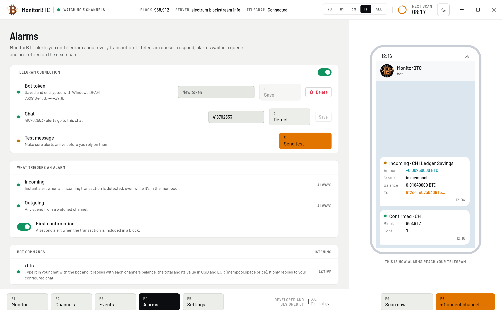
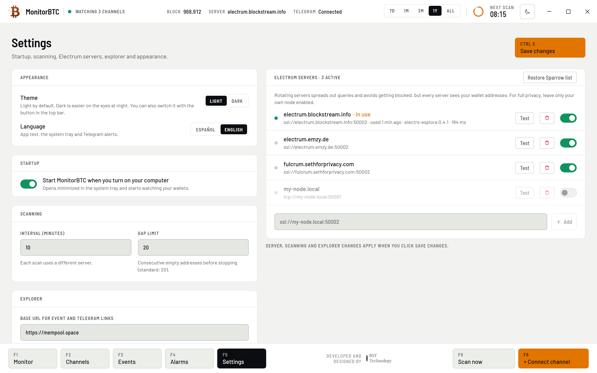

  <b>English</b> · <a href="README.es.md">Español</a>

# MonitorBTC

MonitorBTC is a Windows desktop app that watches your single-signature Bitcoin wallets through their extended public
key (xpub, ypub or zpub) and sends you a Telegram alert for every incoming or outgoing transaction.

It is read-only: it never asks for your seed phrase and it cannot move your funds.

## Download

Download **`MonitorBTC-Setup-1.0.0.exe`** from the [latest release](../../releases/latest).

Requirements: Windows 10 or 11 (64-bit).

## Installation

1. Run `MonitorBTC-Setup-1.0.0.exe`. It installs for your user only (no administrator rights needed) and opens
   MonitorBTC when it finishes.
2. If Windows shows **“Windows protected your PC”**, click **More info** and then **Run anyway**. The installer is not
   code-signed yet, so SmartScreen doesn’t recognize it.

## First-run setup

The first time MonitorBTC opens, a five-step wizard guides you through the setup. Steps 3 and 4 are optional (**Skip
this step**) and you can do them later from the app: the wallet with F6 and Telegram with F4. If you skip step 3, the
wizard skips the Telegram step too.

### Step 1 · Welcome

Choose the language (**Español** or **English**) and click **Get started**. You can change the language later in
**Settings**.

### Step 2 · Start with Windows

MonitorBTC can only alert you while it is running, even if it’s only in the system tray. Leave **Start MonitorBTC when you
turn on your computer** on so it opens minimized to the tray every time you sign in to Windows, and click **Next**.

### Step 3 · First wallet (optional)

1. Copy your wallet’s extended public key (xpub, ypub or zpub) from your wallet app. For example: in Sparrow it is under
   **Settings › Keystore**; in Electrum, under **Wallet › Information**.
2. Paste it in **Extended public key**. With a ypub or zpub, the derivation path is filled in for you. With an xpub,
   choose the type your wallet uses: 44' Legacy, 49' Nested, 84' Native SegWit (selected by default) or 86' Taproot.
3. Check that the three addresses under **Verification** match the first receiving addresses in your wallet.
4. Type a name in **Channel name** (optional) and click **Add wallet**.

> [!WARNING]
> Never enter your seed phrase (recovery words) or an xprv. MonitorBTC only needs the public key.

The first scan sets the baseline: past transactions don’t trigger alerts, only new ones.

### Step 4 · Telegram (optional)

1. In Telegram, open **@BotFather**, send `/newbot` and follow the steps. At the end it gives you the bot’s token.
2. Paste the token in **Bot token** and click **Save** (1).
3. Open the chat with your new bot and send it `/start`. Then click **Detect** (2) to fill in your chat ID.
4. Click **Send test** (3) and check that the message reaches Telegram. Then click **Continue**.

### Step 5 · Finish

It shows a summary of your setup. Click **Open MonitorBTC** to start.

## Everyday use

| Key | What it does |
| --- | --- |
| F1 | Monitor: total balance and one trace per wallet |
| F2 | Channels: details of each wallet, its receiving address and its transactions |
| F3 | Events: every transaction, grouped by day |
| F4 | Alarms: Telegram connection and alerts |
| F5 | Settings |
| F6 | Connect channel: add another wallet |
| F9 | Scan now |

Closing the window doesn’t stop MonitorBTC: it keeps watching from the system tray (if you don’t see its icon, click the
^ arrow next to the clock). Click the icon, or open MonitorBTC again from the Start menu, to bring the window back. To
quit, right-click the tray icon and choose **Quit**.

### Add more wallets (F6)

Press F6 or click **+ Connect channel** to open the same form as in step 3; at the end, click **Connect channel**. Each
wallet becomes a channel with its own color.

### Telegram alarms (F4)

- MonitorBTC checks your wallets every 10 minutes by default (you can change it in **Settings › Scanning**), so an
  alert can take up to that long to arrive. Press F9 to scan right away.
- You get an alert for every new incoming or outgoing transaction and, if it was still unconfirmed when detected,
  another when it gets its first confirmation (**First confirmation** option, on by default).
- Send `/btc` to your bot to get the balance of each wallet as of the last scan, the total and its value in USD and EUR.
  The bot only replies to the chat you set up, and only while MonitorBTC is running: commands sent while your computer
  is off are ignored.
- If Telegram doesn’t respond, alerts are queued and retried on the next scan. If you pause alerts with the switch in
  **Telegram connection**, alerts from that period are discarded.

### Settings (F5)

Theme (light or dark), language, start with Windows, scan interval (10 minutes by default) and gap limit, Electrum
servers and the block explorer used for links. Changes to scanning, servers and the explorer take effect when you click
**Save changes** (Ctrl+S).

## Privacy

- MonitorBTC queries the public Electrum servers listed in Sparrow Wallet, a different one on each scan. Each server you
  query can see your wallets’ addresses and your IP address. For full privacy, add your own node (`ssl://host:port`, or
  `tcp://host:port` on your local network) under **Settings › Electrum servers**, turn off the others and click **Save
  changes**.
- Alerts and `/btc` replies go through Telegram, which can see the amounts, balances and channel names they contain.
- The Telegram bot token is stored encrypted with Windows DPAPI.
- Your data is stored in `%APPDATA%\MonitorBTC`.

## Uninstall

Go to **Windows Settings › Apps › Installed apps** (**Apps & features** on Windows 10), find MonitorBTC and choose
**Uninstall** (on Windows 11, from its **⋯** menu). Uninstalling also removes the start with Windows. Your data in
`%APPDATA%\MonitorBTC` is kept; delete that folder if you also want to remove it.

---

Developed and designed by [BST Technology](https://bst.technology).
